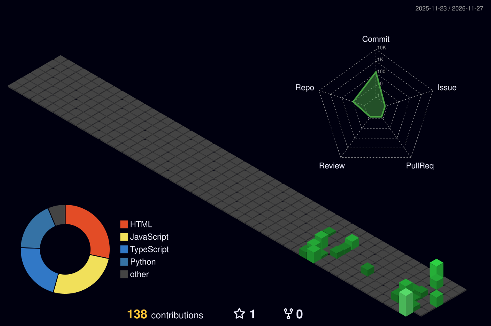

<div align="center">

<!-- Header Dynamic Banner -->


<!-- Interactive Typing SVG -->
<a href="https://github.com/roshan-2026">
  
</a>

<p align="center">
  <a href="https://github.com/roshan-2026?tab=followers"></a>
  <a href="https://github.com/roshan-2026"></a>
</p>

</div>

---

### 📜 `inventory.log`

```yaml
player: "Roshan Nishad"
alias: "@roshan-2026"
role: "Full-Stack Developer & Software Engineering Student"
guild: "Lovely Professional University (LPU)"
current_quest: "Architecting full-stack web applications, AI tools & cloud microservices"
philosophy: "Punch trees first, figure out crafting recipes later."
active_buffs: ["Continuous Learning", "High Focus", "Coffee Boost"]
```

---

### 🛠️ `crafting_table` (Tech Stack)

<div align="center">

#### Languages
<p>
  
  
  
  
  
  
  
</p>

#### Frameworks & Libraries
<p>
  
  
  
  
  
</p>

#### Databases & DevOps
<p>
  
  
  
  
  
  
</p>

</div>

---

### 📦 `chest_contents` (Featured Projects)

<details open>
<summary><b>Click to open the chest</b></summary>
<br/>

| Project | Description | Stack | Status |
| :--- | :--- | :--- | :--- |
| **⚡ [Full-Stack Platform](https://github.com/roshan-2026)** | Interactive, performant web applications with end-to-end integration. | `React` `Node.js` `MongoDB` | `Active` |
| **🤖 [AI & Automation Utilities](https://github.com/roshan-2026)** | Explorations in agentic systems, script automation, and LLM tooling. | `Python` `FastAPI` | `Building` |
| **🎯 [Algorithm & Data Structures Lab](https://github.com/roshan-2026)** | Clean, optimized implementations of core computer science fundamentals. | `C++` `Python` | `Refining` |

</details>

---

### 📊 `xp_bar` & Activity Stats

<div align="center">
  <table border="0">
    <tr>
      <td>
        
      </td>
      <td>
        
      </td>
    </tr>
    <tr>
      <td colspan="2" align="center">
        
      </td>
    </tr>
  </table>
</div>

---

### 🌍 `world_map` (3D Contribution Calendar)

<div align="center">
  
</div>

> *Note: Generated automatically everyday at 18:00 UTC via GitHub Actions.*

---

### 👾 The Enderman eating my commit blocks

<div align="center">
  <picture>
    <source media="(prefers-color-scheme: dark)" srcset="https://raw.githubusercontent.com/roshan-2026/roshan-2026/output/github-snake-dark.svg">
    <source media="(prefers-color-scheme: light)" srcset="https://raw.githubusercontent.com/roshan-2026/roshan-2026/output/github-snake.svg">
    
  </picture>
</div>

---

### 📬 Connect With Me

<div align="center">
  <a href="mailto:roshan.nishad2026@lpu.in">
    
  </a>
  <a href="https://github.com/roshan-2026">
    
  </a>
</div>

<br/>

<div align="center">
  
</div>
